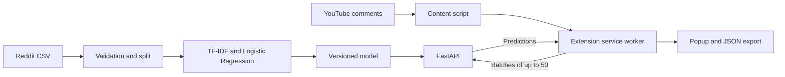

# YouTube Comment Sentiment

A Chrome extension extracts loaded YouTube comments and sends them in batches to a FastAPI service. A scikit-learn model predicts negative, neutral, or positive sentiment. The popup shows a distribution, probabilities, and filterable comments.



## Run the local project

Install Python 3.13, [uv](https://docs.astral.sh/uv/), and Chrome. Run commands from the repository root.

```sh
uv sync --locked --group train
uv run python main.py
```

Open [the API documentation](http://127.0.0.1:7860/docs). The checked-in model is ready to use. Its version, dependency versions, and input checksum are recorded in [model metadata](models/metadata.json).

1. Open `chrome://extensions` and enable **Developer mode**.
2. Choose **Load unpacked** and select the `chrome-extension` folder.
3. Open or reload a YouTube watch page, scroll down to load comments, and open **YouTube Sentiment** from the toolbar.
4. Click **Analyze comments**. Use the sentiment filter to inspect comments or limit the results copied/exported. The theme setting is saved across sessions.

The extension reads up to 250 displayed comments per run, including expanded replies. Scroll further and analyze again to include newly loaded comments within that limit. The popup reports how many comments it analyzed or skipped. Results remain available when you reopen the popup on the same video. Comment text is sent to the configured API only when you start an analysis.

See the [extension guide](docs/extension-guide.md) for screenshots and troubleshooting.

## Reproduce the data and model

```sh
uv run python -m youtube_sentiment.data.download
uv run python -m youtube_sentiment.data.prepare
uv run --group train python -m youtube_sentiment.data.explore
uv run python -m youtube_sentiment.models.train
uv run python -m youtube_sentiment.models.benchmark
uv run --group train python scripts/build_report.py
```

Use `--local path/to/reddit.csv` with the download command to validate and import a copy of the assignment dataset. Use `--force` to refresh the cached raw file from the assignment URL. The project saves original rows under `data/raw`, normalizes column names in `data/processed`, and uses a seed-42 stratified 80/20 split after normalized-text deduplication.

Training compares a majority baseline and a linear SVM with Logistic Regression. The three-fold grid search selects TF-IDF and classifier parameters by macro F1. The held-out Reddit test results, confusion matrix, and 50-comment inference timing are in [metrics.json](reports/metrics.json). See the [technical report](reports/rapport-technique.pdf) for the figures and discussion. The benchmark measures model work with a warm model, while the popup's API time includes the HTTP round trips.

## API examples

```sh
curl http://127.0.0.1:7860/health
curl http://127.0.0.1:7860/predict_batch \
  -H 'Content-Type: application/json' \
  -d '{"comments":[{"id":"c1","text":"This tutorial was genuinely helpful!"}]}'
```

On Windows PowerShell, use:

```powershell
$body = @{ comments = @(@{ id = 'c1'; text = 'This tutorial was helpful!' }) } | ConvertTo-Json -Depth 4
Invoke-RestMethod http://127.0.0.1:7860/predict_batch -Method Post -ContentType 'application/json' -Body $body
```

| Endpoint | Behavior |
|---|---|
| `GET /health` | Readiness and model version; HTTP 503 when the artifact cannot load |
| `POST /predict_batch` | 1–50 comments with unique IDs and text of 1–5,000 characters. Returns ordered results, sentiment counts and percentages, model version, and inference time |
| `GET /docs` | OpenAPI UI with the request and response schemas |

Labels are `-1` negative, `0` neutral, and `1` positive. Confidence is the model probability for its predicted class. Text that becomes empty after cleaning has status `skipped` and is excluded from percentage calculations. Invalid batches receive HTTP 422.

The service reads `MODEL_DIR` and optional comma-separated `CORS_ORIGINS` from the environment. For example, set `CORS_ORIGINS=chrome-extension://your-extension-id` if you need an explicit CORS origin. Load only model artifacts you trust.

## Docker and Hugging Face Spaces

```sh
docker build -t youtube-sentiment .
docker run --rm -p 127.0.0.1:7860:7860 youtube-sentiment
```

Deploy to a Docker Space from an authenticated Hugging Face account. Choose your Space name and intended visibility. The browser extension needs an API origin it can access, so a public Space is the simplest configuration for a classroom demonstration.

```sh
uvx --from huggingface-hub hf auth login
uv run --with huggingface-hub python scripts/deploy_space.py OWNER/SPACE --visibility public
```

Once the Space reports that it is running, obtain its direct `https://…hf.space` origin and check `/health`, `/docs`, and a sample prediction against that origin. Confirm the model version matches the release. Build the extension ZIP with the same verified origin:

```sh
uv run python scripts/package_extension.py --api-url https://OWNER-SPACE.hf.space
```

For a local ZIP, omit `--api-url`. Extract the ZIP and select the extracted folder in Chrome's **Load unpacked** dialog.

## Validation

```sh
uv run ruff check src tests scripts app_api.py main.py
uv run pytest -q
npm ci
npm test
npx playwright install chromium
npm run test:e2e
```

The browser test installs the extension in an isolated Chromium profile, supplies a controlled YouTube comment page, and sends predictions to the real local API. It checks results, filters, the JSON download, dark mode, persistence, and a server outage. Use `npm run test:e2e -- --live` for a separate check on a public YouTube watch page. The test requires local port 7860 to be free.

The [French demo video](reports/demonstration.mp4) shows installation, analysis of a public YouTube video, filters, themes, export, and local API timing. The [demo runbook](docs/demo-runbook.md) lists the steps for reproducing the demonstration.
