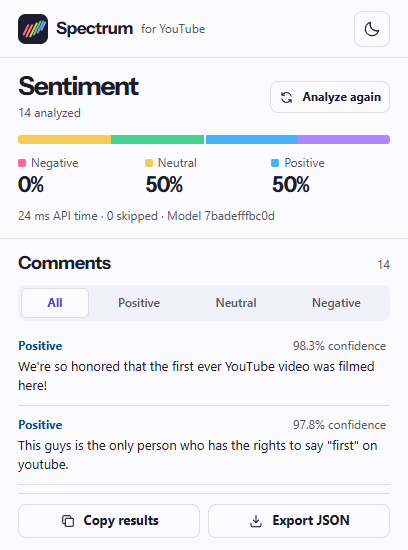
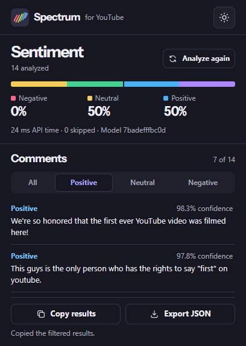
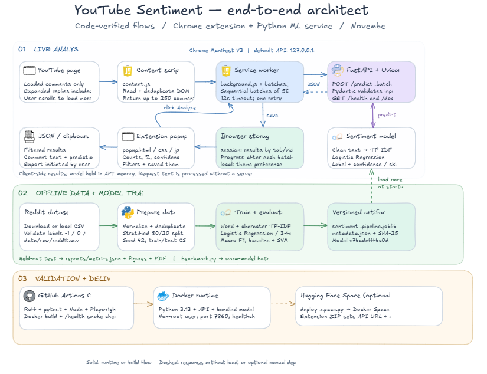

<p align="center">
  
</p>

<h1 align="center">Spectrum for YouTube</h1>

<p align="center">
  See how a video's loaded comments split between positive, neutral, and negative.
  <br>
  A Chrome extension with a FastAPI service and a bundled scikit-learn model.
</p>

<p align="center">
  <a href="https://github.com/4ymaneBH/youtube_sentiment_analyses/actions/workflows/ci.yml"></a>
  
  
</p>

<p align="center">
  <a href="#quick-start">Quick start</a> ·
  <a href="#architecture">Architecture</a> ·
  <a href="#model-results">Model results</a> ·
  <a href="#api">API</a> ·
  <a href="#development">Development</a> ·
  <a href="reports/demonstration.mp4">Watch the demo (FR)</a>
</p>

<div align="center">
<table>
  <tr><th>Light mode</th><th>Dark mode with the positive filter</th></tr>
  <tr>
    <td align="center" valign="top"></td>
    <td align="center" valign="top"></td>
  </tr>
</table>
</div>

## Quick start

You’ll need [Python 3.13](https://www.python.org/downloads/), [uv](https://docs.astral.sh/uv/), and Chrome. The trained model is included in the repository.

```sh
git clone https://github.com/4ymaneBH/youtube_sentiment_analyses.git
cd youtube_sentiment_analyses
uv sync --locked
uv run python main.py
```

1. Open `chrome://extensions`, enable **Developer mode**, and choose **Load unpacked**. Select the [`chrome-extension`](chrome-extension/) folder.
2. Open a YouTube watch page and scroll to the comments. Expand replies you want to include.
3. Open **YouTube Sentiment** from the Chrome toolbar and click **Analyze comments**.

Spectrum analyzes up to **250 comments already loaded on the page**. Use the segmented filter to review one sentiment, then copy or export the filtered rows as JSON. Results stay available when you reopen the popup on the same video.

The extension sends comment text to the configured API when you start an analysis. The default endpoint is on your machine at `127.0.0.1:7860`.

[Extension guide and troubleshooting](docs/extension-guide.md) · [Local API docs](http://127.0.0.1:7860/docs)

## Architecture

[](docs/architecture/youtube-sentiment-architecture.png)

| Flow | What happens |
| --- | --- |
| Live analysis | The content script reads loaded comments. The service worker sends batches of up to 50 to FastAPI and saves results by tab and video for the popup. |
| Offline training | The Reddit dataset is validated and deduplicated before a stratified 80/20 split. Cross-validation selects a TF-IDF and logistic regression pipeline that is saved as a versioned Joblib artifact. |
| Validation and delivery | GitHub Actions runs linting, Python and JavaScript tests, the Chromium extension flow, and a Docker health check. A Docker Space is an optional hosting target. |

## Model results

Measured on **7,315 held-out Reddit comments** using model `7badefffbc0d`.

| Metric | Result |
| --- | ---: |
| Accuracy | **88.35%** |
| Macro F1 | **0.873** |
| F1 by class | 0.804 negative · 0.922 neutral · 0.893 positive |
| Warm inference p95, 50 comments | **82.6 ms** |

The latency benchmark measures warm model inference on the test machine. The popup shows the API round-trip time. The accuracy and F1 scores apply to the Reddit test set.

[Full metrics](reports/metrics.json) · [Confusion matrix](reports/figures/confusion.png) · [Model metadata](models/metadata.json) · [Technical report (FR)](reports/rapport-technique.pdf)

## API

The server exposes interactive documentation at [`/docs`](http://127.0.0.1:7860/docs).

| Endpoint | Response |
| --- | --- |
| `GET /health` | Readiness and model version. Returns HTTP 503 when the model is unavailable. |
| `POST /predict_batch` | Ordered predictions, class counts and percentages, model version, and inference time. |

```sh
curl http://127.0.0.1:7860/health
curl http://127.0.0.1:7860/predict_batch \
  -H 'Content-Type: application/json' \
  -d '{"comments":[{"id":"c1","text":"This tutorial was helpful!"}]}'
```

<details>
<summary>PowerShell example and request limits</summary>

```powershell
$body = @{ comments = @(@{ id = 'c1'; text = 'This tutorial was helpful!' }) } | ConvertTo-Json -Depth 4
Invoke-RestMethod http://127.0.0.1:7860/predict_batch -Method Post -ContentType 'application/json' -Body $body
```

A batch takes 1–50 comments. IDs must be unique within the batch and text must contain 1–5,000 characters after trimming. Invalid batches return HTTP 422. The labels are `-1` negative, `0` neutral, and `1` positive. Text emptied by preprocessing is marked `skipped` and excluded from percentages.

Set `MODEL_DIR` to load a different trusted model directory. Set `CORS_ORIGINS` to a comma-separated list of allowed origins when needed.

</details>

## Development

<details>
<summary>Reproduce training and the report</summary>

```sh
uv sync --locked --group train
uv run python -m youtube_sentiment.data.download
uv run python -m youtube_sentiment.data.prepare
uv run --group train python -m youtube_sentiment.data.explore
uv run python -m youtube_sentiment.models.train
uv run python -m youtube_sentiment.models.benchmark
uv run --group train python scripts/build_report.py
```

Pass `--local path/to/reddit.csv` to import an existing copy, or `--force` to refresh the raw dataset. Training compares a majority baseline and a linear SVM with logistic regression. The three-fold grid search selects parameters by macro F1.

</details>

<details>
<summary>Run tests</summary>

Use Node.js 22 for the extension tests. The browser test needs port 7860 free so it can start its own API.

```sh
uv run ruff check src tests scripts app_api.py main.py
uv run pytest -q
npm ci
npm test
npx playwright install chromium
npm run test:e2e
```

Pass `-- --live` to `npm run test:e2e` to check the extension on a public YouTube video.

</details>

<details>
<summary>Package the extension or deploy the API</summary>

Build a ZIP for the local API with `uv run python scripts/package_extension.py`. Extract `dist/youtube-sentiment.zip` before selecting **Load unpacked**.

```sh
docker build -t youtube-sentiment .
docker run --rm -p 127.0.0.1:7860:7860 youtube-sentiment
```

To deploy to a public Hugging Face Docker Space, replace `OWNER/SPACE` with your target repository.

```sh
uvx --from huggingface-hub hf auth login
uv run --with huggingface-hub python scripts/deploy_space.py OWNER/SPACE --visibility public
```

Verify `/health` and `/predict_batch` on the Space’s HTTPS origin. Then package the extension with that origin using `uv run python scripts/package_extension.py --api-url https://OWNER-SPACE.hf.space`. The packaging script sets the API URL and corresponding Chrome host permission.

</details>
