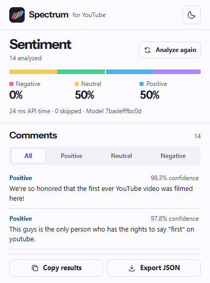
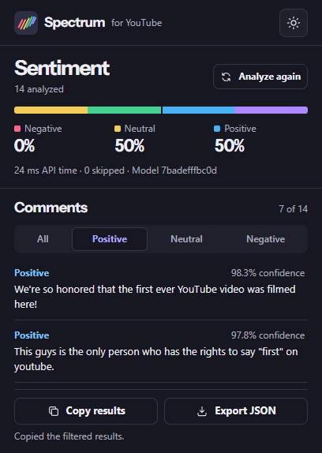

# Spectrum for YouTube

Start the local API with `uv run python main.py` and wait for the health endpoint to return `ok`. Load the source folder or the unpacked release ZIP from Chrome's Extensions page. Pin the extension if you want it to stay visible next to the address bar.

On a YouTube watch page, scroll to the comments before opening the popup. The extension scans the comments already displayed by YouTube, including expanded replies. Use **Analyze again** after scrolling further or switching videos.

- **Sentiment summary** shows the three sentiment shares, analyzed and skipped counts, model version, and accumulated API round-trip time.
- The **sentiment filter** switches between all comments, a single predicted class, and skipped comments when present. Tab to the filter and use the arrow keys to switch options. It leaves the overall distribution visible.
- **Copy results** puts the filtered rows in the clipboard as JSON.
- **Export JSON** downloads the same rows with the video ID, model version, and a summary for the current filter.
- The **moon or sun button** switches and saves the popup theme.

If no comments are shown, scroll to the comment section and try again. Videos with comments disabled cannot be analyzed. If the extension was installed while the video was open, reload the page to attach the content script. If the API is unavailable, check its health endpoint and retry. Partial results remain visible when a later batch fails.

The underlying model was evaluated on labeled Reddit comments. Interpret YouTube scores in the context of language, irony, and the comments you actually loaded.
